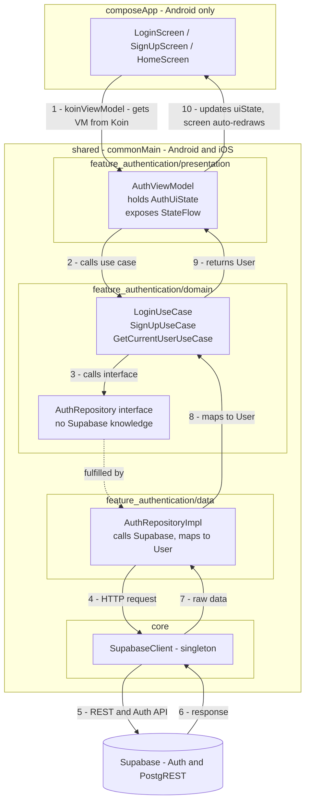
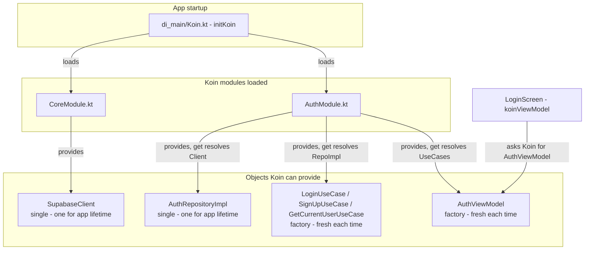

# Safenose Architecture Guide

A personal reference for understanding why every file is where it is and how the whole system fits together.

---

## Visual: Full Data Flow (User taps Login → Supabase → screen redraws)



---

## Visual: How Koin Wires Everything (DI chain)



---

## The Big Picture: Why Two Modules?

The project has two Gradle modules: `shared` and `composeApp`.

- **`shared`** — the brain. Knows how to fetch fragrances, log in a user, post a review. Has zero opinion about what buttons look like.
- **`composeApp`** — the face. Knows what everything looks like on an Android screen. Has zero opinion about how data is fetched.

The reason for this split is **iOS**. When the iOS app is built, it will use the same `shared` brain but a completely different face (SwiftUI in `iosApp`). Logic is written once, used on both platforms.

If UI and logic were mixed together (like older Android apps), everything would have to be rewritten for iOS.

---

## What Lives in `shared`?

Everything under:
```
shared/src/commonMain/kotlin/org/wickedtools/safenose/
```

This is pure Kotlin — no Android imports, no iOS imports. Just business logic.

### `core/`

Things that every feature needs. Not specific to any one feature — used by everything.

```
core/
  data/remote/SupabaseClient.kt   ← the one connection to your Supabase database
  di/CoreModule.kt                ← teaches Koin how to provide that connection
  domain/model/User.kt            ← what a "user" looks like across the whole app
```

`User.kt` lives in `core` and NOT in `feature_authentication` because the profile screen,
the reviews screen, and the auth screen all need to know what a user is. If it lived inside
`feature_authentication`, other features would have to import from authentication — creating
messy cross-feature dependencies.

### `feature_*/`

Each feature is a self-contained vertical slice of the app:

```
feature_authentication/
feature_fragrance/
feature_reviews/
feature_userrating/
feature_safenoserating/
feature_profile/
feature_like/
feature_complementbox/
feature_search/
feature_share/
```

Every feature has the same four internal layers.

---

## Why Every Feature Has Four Layers

This pattern is called **Clean Architecture**. Each layer has exactly one job and they only
communicate in one direction. Using `feature_authentication` as the example:

```
feature_authentication/
  data/          ← HOW we get data (calls Supabase)
  domain/        ← WHAT the rules are (pure Kotlin interfaces)
  presentation/  ← WHAT the ViewModel exposes to the UI
  di/            ← HOW Koin wires it all together
```

---

### `domain/` — The Rules Layer (most important)

Answers: *what needs to happen?*

Contains three things:

**`domain/model/`** — what your data looks like inside the app (not the raw Supabase response):
```kotlin
data class User(
    val id: String,
    val email: String,
    val city: String
)
```

**`domain/repository/`** — a contract (interface) that says what operations exist, without saying how:
```kotlin
interface AuthRepository {
    suspend fun login(email: String, password: String): User
    suspend fun signup(email: String, password: String, city: String): User
}
```
This interface lives in `domain` because the rules don't care if data comes from Supabase,
Firebase, or a local file. The rule just says "I need to be able to log in."

**`domain/usecases/`** — one class per action the user can take:
```kotlin 
class LoginUseCase(private val repository: AuthRepository) {
    suspend operator fun invoke(email: String, password: String): User {
        // Validation logic can go here before calling the repository
        return repository.login(email, password)
    }
}
```
The ViewModel calls this use case, not the repository directly. If login rules ever change
(e.g. add 2FA), only this one file changes.

**Why is `domain/` independent?**
It imports nothing from Android, nothing from Supabase, nothing from Koin. Pure Kotlin only.
This means all business logic can be tested without a phone, without a database, without anything.

---

### `data/` — The Implementation Layer

Answers: *how do we actually do it?*

**`data/repository/AuthRepositoryImpl.kt`** — the real implementation of the `domain/` contract:
```kotlin
class AuthRepositoryImpl(
    private val supabaseClient: SupabaseClient  // provided by Koin
) : AuthRepository {                            // fulfills the domain/ contract

    override suspend fun login(email: String, password: String): User {
        val result = supabaseClient.auth.signInWith(Email) {
            this.email = email
            this.password = password
        }
        // Converts Supabase's response into YOUR app's User model
        return User(
            id = result.id,
            email = result.email,
            city = ""
        )
    }
}
```

`domain/` defines *what* login means. `data/` defines *how* it actually calls Supabase.
The ViewModel never knows Supabase exists — it only knows the `AuthRepository` interface.

**`data/data_source/`** — if the repository gets complex, it can be split into a remote data 
source (Supabase) and a local data source (cached data). For the MVP, keep logic inside the
repository itself.

---

### `presentation/` — The ViewModel Layer

Answers: *what does the UI need to display?*

The ViewModel sits between the domain layer and the UI. It:
1. Calls use cases
2. Holds state (loading, data, errors)
3. Exposes that state to the UI via `StateFlow`

```kotlin
class LoginViewModel(
    private val loginUseCase: LoginUseCase  // provided by Koin
) : ViewModel() {

    private val _uiState = MutableStateFlow(LoginUiState())
    val uiState: StateFlow<LoginUiState> = _uiState.asStateFlow()

    fun onLoginClicked(email: String, password: String) {
        viewModelScope.launch {
            _uiState.update { it.copy(isLoading = true) }
            try {
                val user = loginUseCase(email, password)
                _uiState.update { it.copy(isLoading = false, user = user) }
            } catch (e: Exception) {
                _uiState.update { it.copy(isLoading = false, error = e.message) }
            }
        }
    }
}

data class LoginUiState(
    val isLoading: Boolean = false,
    val user: User? = null,
    val error: String? = null
)
```

The ViewModel lives in `shared` so the iOS SwiftUI code can use the exact same ViewModel.
Login logic is written once.

---

### `di/` — The Wiring Layer

Answers: *how does everything find each other?*

Koin is a dependency injection framework. Its job is to be a factory that creates objects
and provides them wherever needed.

Without DI, you'd repeat this everywhere:
```kotlin
// Messy manual wiring in every single screen
//val client = SupabaseClient(...)
//val repo = AuthRepositoryImpl(client)
//val useCase = LoginUseCase(repo)
//val viewModel = LoginViewModel(useCase)
```

With Koin, you define it once in `feature_authentication/di/AuthModule.kt`:
```kotlin
//val authModule = module {
//    single<AuthRepository> { AuthRepositoryImpl(get()) }  // get() = Koin finds SupabaseClient
//    factory { LoginUseCase(get()) }                        // get() = Koin finds AuthRepository
//    viewModel { LoginViewModel(get()) }                    // get() = Koin finds LoginUseCase
//}
```

Then in your Compose screen:
```kotlin
val viewModel: LoginViewModel = koinViewModel()  // Koin builds the whole chain automatically
```

Koin follows the chain: `LoginViewModel` needs `LoginUseCase`, which needs `AuthRepository`,
which needs `SupabaseClient` — all resolved automatically.

---

## What is a ViewModel?

Think of your app having two separate worlds:

- **UI** — the buttons, text fields, screens (Compose in your case)
- **Data/Logic** — fetching from Supabase, validating inputs, tracking state

A **ViewModel sits in between**. It holds the current state of a screen and handles user actions.

### The Core Problem It Solves

Imagine a user starts typing their email on the login screen, then rotates their phone. Android **destroys and recreates** the screen on rotation. Without a ViewModel, the email they typed is gone.

The ViewModel survives rotation. It outlives the screen.

```
User rotates phone
    ↓
Screen destroyed → recreated
    ↓
ViewModel? Still alive. State preserved.
```

### The Flow

```
User taps "Login"
    ↓
Screen calls → viewModel.onLoginClicked(email, password)
    ↓
ViewModel calls → loginUseCase(email, password)  [calls Supabase]
    ↓
ViewModel updates → _uiState (isLoading=true, then currentUser=user)
    ↓
Screen sees new state → redraws automatically
```

The screen never touches Supabase directly. It only talks to the ViewModel.
The ViewModel never touches Compose directly. It only updates state.

**Why this separation matters:**
- **Testable** — you can test ViewModel logic without any UI
- **Survives rotation** — state is preserved
- **Single source of truth** — one place owns what the screen shows

---

## What Does Koin Actually Do? (AuthModule Explained)

### The Problem Koin Solves

`AuthViewModel` needs a `LoginUseCase`. `LoginUseCase` needs an `AuthRepository`. `AuthRepository` needs a `SupabaseClient`. Without Koin, every screen that wants an `AuthViewModel` would have to manually build this chain:

```kotlin
// Without Koin — you'd write this everywhere
//val client = SupabaseClient(...)
val repo = AuthRepositoryImpl(client)
val loginUseCase = LoginUseCase(repo)
val signUpUseCase = SignUpUseCase(repo)
val getCurrentUserUseCase = GetCurrentUserUseCase(repo)
val viewModel = AuthViewModel(loginUseCase, signUpUseCase, getCurrentUserUseCase)
```

That's messy and duplicated. Koin automates this wiring.

### What AuthModule.kt Does

```kotlin
//val authModule = module {
//    single<AuthRepository> { AuthRepositoryImpl(get()) }  // (1)
//    factory { LoginUseCase(get()) }                        // (2)
//    factory { SignUpUseCase(get()) }
//    factory { GetCurrentUserUseCase(get()) }
//    factory { AuthViewModel(get(), get(), get()) }         // (3)
//}
```

**(1) `single<AuthRepository>`** — Creates one `AuthRepositoryImpl` for the entire app lifetime. `get()` tells Koin "fetch `SupabaseClient` from wherever it's registered" (registered in `CoreModule`).

**(2) `factory`** — Creates a **new instance** each time something asks for it. Every time a screen needs a `LoginUseCase`, it gets a fresh one.

**(3) `factory { AuthViewModel(get(), get(), get()) }`** — The three `get()` calls fetch `LoginUseCase`, `SignUpUseCase`, and `GetCurrentUserUseCase` automatically by their type.

### How `get()` Knows What to Fetch

Koin matches by **type**. When building `AuthViewModel(get(), get(), get())`, Koin sees the constructor expects `LoginUseCase`, `SignUpUseCase`, `GetCurrentUserUseCase` — so it looks up each type in its registry and injects them.

### The Full Chain at Runtime

When your screen calls `koinViewModel<AuthViewModel>()`, Koin:
1. Sees it needs `AuthViewModel` → looks up its `factory`
2. `AuthViewModel` needs `LoginUseCase` → creates it via its `factory`
3. `LoginUseCase` needs `AuthRepository` → returns the existing `single` instance
4. `AuthRepository` was built with `SupabaseClient` → already registered in `CoreModule`

Everything wires up automatically. You never write that manual chain again.

---

## `di_main/Koin.kt` — The Master Switch

The one file that starts Koin and loads every feature's module:

```kotlin
//fun initKoin() {
//    startKoin {
//        modules(
//            coreModule,        // provides SupabaseClient
//            authModule,        // provides auth-related classes
//            fragranceModule,   // provides fragrance-related classes
//            reviewsModule,
//            // ... every other feature module
//        )
//    }
//}
```

Called **once** when the app starts — in `MainActivity` on Android, in `iOSApp.swift` on iOS.
After that, Koin is running and every `get()` call resolves automatically.

---

## How `shared` Connects to `composeApp`

```
shared (brain)                    composeApp (face)
──────────────                    ─────────────────
LoginViewModel                    LoginScreen.kt
  exposes uiState         →         val vm = koinViewModel<LoginViewModel>()
  exposes onLoginClicked()          val state by vm.uiState.collectAsState()
                                    Button(onClick = { vm.onLoginClicked(email, pass) })
```

`LoginScreen.kt` in `composeApp`:
- Gets the ViewModel from Koin (`koinViewModel()`)
- Watches the state (`collectAsState()`) — any change automatically redraws the UI
- Calls ViewModel functions on user actions
- Never touches Supabase, never creates repositories — only talks to the ViewModel

---

## The Full Flow: "User Taps Login"

```
LoginScreen (composeApp)
  → calls vm.onLoginClicked(email, password)

LoginViewModel (shared/presentation)
  → calls loginUseCase(email, password)

LoginUseCase (shared/domain)
  → calls authRepository.login(email, password)

AuthRepositoryImpl (shared/data)
  → calls supabaseClient.auth.signInWith(...)
  → converts Supabase result to User model
  → returns User up the chain

LoginViewModel receives User
  → updates _uiState

LoginScreen sees state change
  → Compose redraws automatically
  → navigates to HomeScreen
```

Every layer does exactly one thing. If Supabase changes their API, only `AuthRepositoryImpl`
changes. If the login button moves to a different screen, only the UI changes. Nothing else breaks.

---

## Summary Table

| Folder | Job | Knows about |
|---|---|---|
| `domain/model/` | Defines data shapes | Nothing |
| `domain/repository/` | Defines what operations exist | Only domain models |
| `domain/usecases/` | One class per user action | Repository interfaces |
| `data/repository/` | Actually calls Supabase | Supabase + domain interfaces |
| `presentation/viewmodel/` | Bridges domain and UI | Use cases + StateFlow |
| `di/` | Wires everything with Koin | All of the above |
| `composeApp/screens/` | Draws the UI | Only ViewModels |

---

## The Golden Rule

Knowledge only flows **inward**:

```
composeApp → ViewModel → UseCase → Repository Interface → RepositoryImpl → Supabase
```

The UI knows ViewModels. ViewModels know UseCases. UseCases know Repository interfaces.
The actual Supabase implementation is at the very outer edge.

Nothing at the center knows anything at the edge. This is what makes the architecture
testable, maintainable, and platform-independent.
